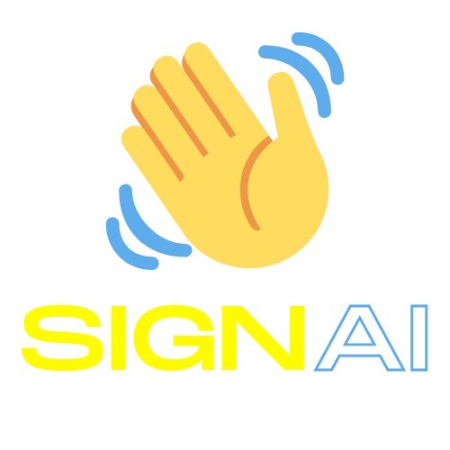
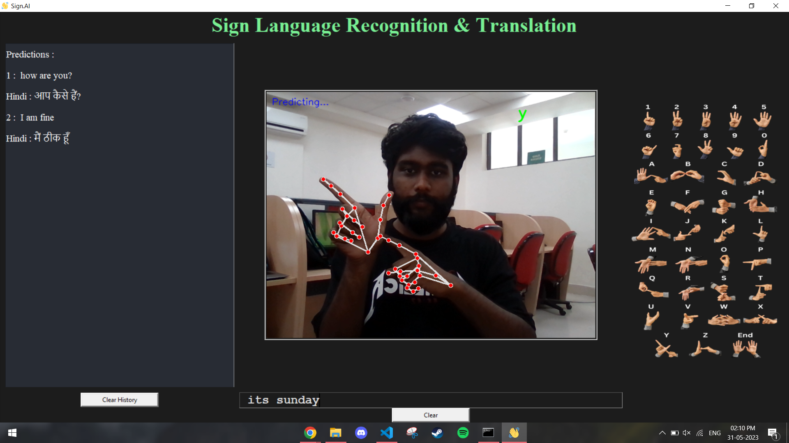

# SignAI: Modern Egyptian Arabic Sign Language Recognition & Translation

<p align="center">
  
  <br />
</p>

SignAI is a clinical-grade Sign Language Recognition and Translation workstation built on top of MediaPipe and Computer Vision. Designed for real-time bidirectional communication between healthcare practitioners and deaf/hard-of-hearing patients, SignAI features Kinematic Geometric Feature Engineering, Deep Neural Classifiers, real-time Arabic text composition, offline Text-to-Speech (TTS), and formatted medical transcript export.

### Core Capabilities:
- **Kinematic Feature Extraction**: 74 rotation-resilient and scale-invariant geometric features (joint flexion angles, radial fingertip spans, inter-digit aperture, and palm-normalized coordinates).
- **High-Accuracy Recognition Models**:
  - **Arabic Fingerspelling Alphabet (31 classes)**: **99.95%** test accuracy.
  - **Dental Clinic Signs (8 vocabulary classes)**: **100.00%** test accuracy.
- **Moatassem.ai Anti-AI High-Craft Desktop Workstation (`app_modern.py`)**:
  - Deep zinc dark palette (`#09090b` canvas, `#141416` panels, `#27272a` hairline borders) with a single emerald accent (`#10b981`).
  - Strict **0% Unicode Emoji ban** across all UI elements, buttons, headers, and system copy.
  - Tabular numerals for timers, frame rates, and confidence metrics.
  - Interactive HUD with customizable hold duration slider (0.5s – 3.0s, default 1.5s) and confidence threshold slider.
  - Bidirectional Doctor-Patient dialogue ledger with doctor quick-response presets.
  - Offline Arabic Text-to-Speech (TTS) readout of patient sign messages.
  - One-click session report export to structured Markdown.

## Quickstart & Launch

```bash
# Navigate to application directory
cd SignAI

# Run Modern High-Craft Workstation
python app_modern.py

# Or run classic interface
python app.py
```

### Running Test Suite:
```bash
python -m unittest discover -s SignAI/tests -p "test_*.py" -v
```

## Model Evaluation:
- **Alphabet Model**: Evaluated on held-out ArSL dataset test split $\rightarrow$ **99.95% Accuracy**.
- **Dental Signs Model**: Evaluated on augmented kinematic dataset $\rightarrow$ **100.00% Accuracy**.
- Evaluation charts generated at `SignAI/model/keypoint_classifier/evaluation_report.png` and `SignAI/model/word_classifier/word_evaluation_report.png`.

## Requirements and Installation

### HARDWARE REQUIREMENTS:

• System Processor: Core i3  
• Hard Disk: 50GB
• Ram: 8 GB

### SOFTWARE REQUIREMENTS:

• Operating system: Windows 10  
• Coding Language: Python  
• Platform: Jupiter Notebook, Pycharm IDE, VSCode

``` 
conda env create -f environment.yml
conda activate project1
python app.py
```

## Structure:

```bash    
SignAI
├── functions
│   └── functions.py
├── images
│   ├── logo.png
│   ├── signs.png
│   ├── signstpb.png
│   └── signstpw.png
├── model
│   ├── keypoint\\\\\\\\\\\\\\\_classifier
│   │   ├── keypoint.csv
│   │   ├── keypoint\\\\\\\\\\\\\\\_classifier.hdf5
│   │   ├── keypoint\\\\\\\\\\\\\\\_classifier.py
│   │   ├── keypoint\\\\\\\\\\\\\\\_classifier.tflite
│   │   └── keypoint\\\\\\\\\\\\\\\_classifier\\\\\\\\\\\\\\\_label.csv
│   └── \\\\\\\\\\\\\\\_\\\\\\\\\\\\\\\_init\\\\\\\\\\\\\\\_\\\\\\\\\\\\\\\_.py
├── SignAI Project Report.pdf
├── app.py
├── environment.yml
├── keypoint\\\\\\\\\\\\\\\_classification.ipynb
├── requirements.txt
├── docs
│   ├── GUI.png
│   ├── logo.png
│   ├── logo2.png
│   ├── signs.png
│   ├── signstpb.png
│   └── signstpw.png
├── LICENSE
└── README.md
```

## GUI:

<p align="center">
  
  <br />
  <br /></p>

# Contact

If you have any questions, suggestions, or feedback, please feel free to contact me at kartik11721@gmail.com

Project Team : Kartik Kumar, Satya Sangram Pattnaik, Deepak, Narendra Tiwari


<a href="https://www.buymeacoffee.com/kartik11721" target="\\\\\\\\\\\\\\\_blank"></a>

